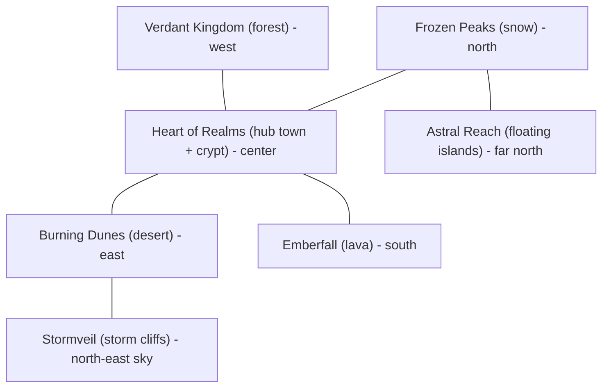

# Open-World Fantasy Game: Project Plan

**Working title:** *Legends of the Lost Realms: Open World* (placeholder)
**New project path:** `C:\Users\X1 YOGA\Documents\3D Lost Realms OpenCode\Lost-Realms-Open-World`
**Original project:** `Legends-of-the-lost-realms\unity-3d` stays read-only. Assets are **copied** into the new project, never moved or linked.

---

## 1. Vision

**Confirmed direction (20 October 2026):** Android phones, with Google Play as the
release destination. The user authorizes development in this open-world project
and reuse of owned assets from the original project, which remains read-only.
Prioritize a polished Verdant slice before expanding the seven-region map.
Use mid-range phones as the confirmed baseline, with higher graphics settings for stronger devices.
30 fps is the initial mobile frame cap, not a verified performance result; offer
60 fps only after thermal and frame-time measurements on suitable devices.
See `Docs/ANDROID_DEVELOPMENT.md` for the current implementation and release gaps.

The current game is a linear chapter game: you hop between floating islands toward a gate. The new game turns the same world into **one continuous, explorable land**. Aster travels on foot between the realms, which become **biomes** of a single map. There are towns, quests, dungeons, bosses, loot and weather.

| Pillar | What it means |
|---|---|
| Explore | Freedom to go anywhere. Landmarks, secrets, caches and the crypt reward curiosity. |
| Fight | Reuse the existing combat feel: parry, dodge, charged attacks, weapon archetypes, attack tokens, telegraphed bosses. |
| Collect | Weapons, skins, relics and gems come from the chest system (the `chest rewards` branch idea). |
| Beauty | Each realm keeps its own look, music and enemies. |

**Core loop:** explore → find a quest, camp or dungeon → fight → loot → grow stronger → unlock the next region.

---

## 2. Asset reuse audit

Total: about **1.4 GB** (`Assets/Art` 473 MB, `Assets/Resources` 737 MB, plus VFX and packs).

| Category | Source in current project | Reuse in new game | Work needed |
|---|---|---|---|
| **Aster (hero)** | `Resources/Characters/Aster*.prefab`, 6 skins, baked clips (`Resources/Animations/Aster`) | Direct | Bring the `AsterPhase1` pipeline and baked clips together. **Do not regress the walk glitch** (root curves flattened, capsule drives locomotion). Keep locomotion tuning locked. |
| **Weapons** | 48 FBX in `Resources/Weapons`, `WeaponCatalog`, hold-attack VFX | Direct | Re-validate grips. Keep the removed-weapon list (Long Sword, Brass Fangs, Verdant Fang stay out). |
| **Enemies and bosses** | ~28 character prefabs, `Art/Enemies`, `EnemyPacks`, `LavaBoss`, Golem and Warden bosses, Stormveil and Astral enemies | Direct | Re-baked clips ship with them. Spawners change from island routes to **open-world camps and patrols**. |
| **Props** | `Props/Nature` (18), `Desert` (7), `Snow` (15), `Village` (27), plus `RPGPP_LT` and `SimpleNaturePack` | Direct | Used for biome scatter. Needs LODs, GPU instancing and collider cleanup. |
| **Traps and hazards** | `Props/Traps`, `Props/Expansion`, `Props/Crypt`, Tripo trap models | Direct | Reuse in dungeons, ruins and camps. |
| **Stormveil and Astral kits** | `Resources/Stormveil`, `Resources/Astral` (terrace, bridge, tower, arch, orrery, pads) | Direct | These become **two late-game regions**. |
| **Islands** | `Resources/Islands` (36 meshes) | **Partial** | Flat platform meshes don't suit open terrain. Use them for **sky islands**, the Astral region and floating ruins. |
| **Gates and portals** | `Resources/Gates` | Direct | Become **fast-travel realm gates** and dungeon entrances. |
| **VFX** | Eric VFX Studio, Free Slash VFX, GabrielAguiar | Direct | Move to a VFX Addressables group. Check URP shader compatibility (see §3). |
| **Audio** | 100 files: realm themes, guardian themes, SFX | Direct | Realm themes become **biome music zones**. |
| **UI** | `Resources/UI` (fonts, button art), relic icons | Partial | The current UI is IMGUI. Reuse the art and rebuild it in uGUI or UI Toolkit. |
| **Scripts (87 files)** | `Assets/Scripts` | **Selective port** | See below. |

### Script porting policy

- **Port and refactor:** hero controller, combat, enemy AI (tokens), weapon system, chest and gacha logic, save data model, VFX helpers.
- **Rewrite:** world and chapter building (`RealmWorld`, `ChapterLayout`), IMGUI screens and the level-flow code. These are tied to the island-chapter structure.
- **Drop:** per-chapter test harnesses and probes. Write new ones for the open world.

---

## 3. Technology decisions (proposed, for your approval)

| Area | Current project | New project | Why |
|---|---|---|---|
| Unity | 6000.6.0f1 | **6000.6.0f1** (same) | No editor migration. |
| Render pipeline | Built-in (`Standard` materials) | **URP** | Better mobile and PC performance, SRP Batcher, shadows and fog for large views. Needs a one-time material conversion. |
| Asset loading | `Resources/` (737 MB) | **Addressables**, grouped by region | `Resources` can't stream a large world. |
| World | One generated scene | **Unity Terrain** per region, **additive scene tiles**, distance-based streaming | Keeps memory flat. |
| Navigation | Custom | **AI Navigation (NavMesh)** per tile | Open-world enemy pathing. |
| Camera | Custom `FollowCamera` | **Cinemachine** (third-person orbit + lock-on) | Proven, tunable. |
| Input | Legacy + touch | **Input System** (touch, gamepad, keyboard) | Cross-platform. |
| UI | IMGUI | **uGUI/UI Toolkit** | Scales, supports a map and inventory. |
| Version control | Git, single repo | **New git repo with Git LFS** | The repo is heavy with FBX, textures and audio. |

---

## 4. World design

**Target size:** about **1.8 km × 1.8 km** (3×3 grid of 600 m tiles). This keeps a mobile-friendly memory budget and still gives about 12–15 minutes to cross.

| Region | Source realm | Content |
|---|---|---|
| **Heart of Realms (hub)** | Verdant start, village props | Town, shops and chests, quest board, Aster's home, crypt entrance |
| **Verdant Kingdom** | Realm 1 | Forests, ruins, first guardian (Heartwood) |
| **Burning Dunes** | Realm 2 | Desert, buildings, Sandstone Colossus guardian |
| **Frozen Peaks** | Realm 3 | Snow, Whiteout boss |
| **Emberfall** | Realm 4 | Lava fields, Lava Boss |
| **Stormveil** | Chapters 16–20 | Conductor puzzles, Tempest Regent |
| **Astral Reach** | Chapters 21–25 | Sky islands, Fractured Keeper |

Region unlock is **soft-gated by difficulty and quests**, not invisible walls. Realm gates act as fast-travel waypoints once discovered.

---

## 5. Gameplay systems

1. **Hero:** third-person controller from the existing Hero (jump, double jump, dodge, parry, charged attack, power element select: Ember/Frost/Gale).
2. **Combat:** attack tokens, weapon archetype perks (heavy hyper-armor, pole tipper, flurry backstab), boss telegraphs, stagger.
3. **Enemies:** camps, patrols, roaming elites, region guardians. Aggro and leash rules replace island anchors.
4. **Quests:** main questline (restore the realm gates), side quests, bounties. The existing objective types become quest types: shrines, keys, elemental foci, rituals, rally outposts, caches.
5. **Loot and economy:** gems, coins, **three-tier chests** (normal / golden / epic), weapons and skins by rarity, rewarded ads (test ad only until publishing). Few common weapons are found in the world.
6. **Progression:** Aether, health and Aether potions (the new purple potion), relics, build and talent progression (reuse `BuildProgression`).
7. **Exploration:** fog-of-war map, discoverable landmarks, hidden caches, crypt dungeons, fast-travel gates.
8. **World feel:** day/night, weather per biome, ambient audio zones, distance fog (the existing height-fog shader concept ports to URP).
9. **Save system:** extend the existing save model with world state (discovered POIs, cleared camps, quest flags).

---

## 6. Roadmap

Each phase ends with a **playable build and a written validation report**, using the same discipline as the current project.

| Phase | Goal | Deliverables | Done when |
|---|---|---|---|
| **0. Foundation** (this step) | Empty new project, folder structure, repo | Project created, `AGENTS.md`-style guardrails, `Docs/` | Project opens with 0 errors. |
| **1. Asset migration** | Copy assets in a controlled way | Folder layout, Addressables groups, URP material conversion, import settings preserved, **Aster animation verification** | All models render correctly in URP, no pink materials, Aster walks without the glitch. |
| **2. Hero and camera** | Hero walking on terrain | Hero port, Cinemachine camera, Input System | Walk, jump, dodge on slopes. No sinking, no sliding. |
| **3. Vertical slice: Verdant region** | One complete region | Terrain, scatter props, 1 town, 3 enemy camps, 1 dungeon, 1 guardian | 30 min of fun, stable 60 fps on target device. |
| **4. Combat and loot port** | Full combat and chests | Weapons, enemy AI, chest system, potions | Combat parity with the current game. |
| **5. World streaming and map** | Multiple regions | Tile streaming, fast travel, map UI | Memory flat while crossing the map. |
| **6. Regions 2–7** | Remaining biomes | Region by region, same recipe | Each region passes its own checklist. |
| **7. Polish and release prep** | Audio, UI, performance, ads, store | Optimization pass, real ads, localization if needed | Release candidate. |

**Suggested order:** Phase 0 now. Phases 1–3 are the real test of the concept. Decide on the rest after the vertical slice.

---

## 7. Risks and mitigations

| Risk | Mitigation |
|---|---|
| Aster walk glitch returns after the move | Port the baker, regenerate clips with the Phase 1 menu in the new project, check before any other work. |
| URP turns models pink | Convert materials in a controlled step and run a render probe (magenta% = 0) after shader changes. |
| Memory and download size (about 1.4 GB) | Addressables groups per region, texture compression, LODs, 512/1024 textures. |
| Open world is a big scope jump | Vertical slice first. Everything else repeats its recipe. |
| Island-based scripts don't fit | Rewrite world-building, port only systems that are map-independent. |
| Third-party asset licenses | Audit before shipping (RPGPP, SimpleNaturePack, Eric VFX, GabrielAguiar, Free Slash VFX, Kenney, PurePoly, Mixamo, Tripo). Keep a `LICENSES.md`. |

---

## 8. Questions for you

1. **Platforms:** mobile only, PC only, or both? (This sets the world size and graphics budget.)
2. **Render pipeline:** OK to move to **URP**, or do you prefer to stay on Built-in for easier asset reuse?
3. **Camera:** keep the current third-person orbit camera, or add a lock-on and free-look option?
4. **Scope:** start with the Verdant vertical slice (recommended), or lay out the whole 7-region map first?
5. **Name:** do you want a different title for the new game?

> [!NOTE]
> The earlier bug list in the current game (trap overlaps, chests and keys not disappearing, death light beam, banner colour, gate sink, Aether potion) was only investigated, not changed. I can resume it whenever you want. The new project doesn't depend on it.
